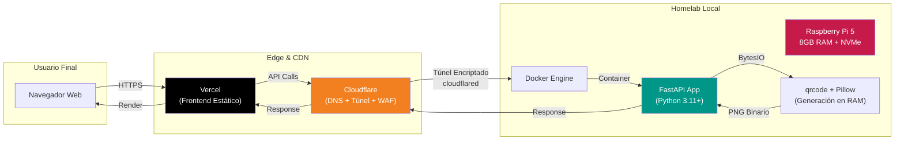

# QR Code Generator

<div align="center">
  
  
  
  <br><br>

  <p>
    
    
    
    
    
    
    
    
    
  </p>
  <br>
</div>

---

## Descripción General y Motivación

**QR Code Generator** nace como un proyecto deliberado de **desarrollo full stack desde cero** para consolidar bases reales de programación. En una era donde la IA genera código a velocidad de luz, este proyecto representa el compromiso de:

- **Escribir cada línea de código manualmente**, entendiendo el *porqué* detrás de cada decisión arquitectónica.
- **Autoalojar infraestructura real** en un homelab, enfrentando desafíos de red, seguridad y despliegue que no existen en entornos *serverless* abstractos.
- **Construir un pipeline completo**: Frontend estático → Túnel seguro → Contenedor en bare-metal → API en memoria.

El resultado: una API REST que genera códigos QR a partir de URLs personalizadas, sirviendo imágenes PNG optimizadas directamente desde RAM (vía `BytesIO`) sin tocar disco, expuesta de forma segura al mundo mediante **Cloudflare Tunnels** desde una **Raspberry Pi 5 con almacenamiento NVMe**.

---

## Arquitectura del Sistema



### Flujo de Datos

| Etapa | Componente | Responsabilidad |
|-------|------------|-----------------|
| **1. Entrega Frontend** | **Vercel** | Sirve `index.html` + `style.css` + JS global con CDN global, TLS automático, *preview deployments*. |
| **2. Entrada Segura** | **Cloudflare Tunnel** | `cloudflared` en la Pi establece túnel saliente (outbound-only), sin puertos abiertos en router, con WAF, DDoS protection y mTLS opcional. |
| **3. Orquestación** | **Docker** | Contenedor ligero (`python:3.11-slim`), restart policy `unless-stopped`, healthcheck en `/health`, logs estructurados. |
| **4. Lógica de Negocio** | **FastAPI** | Endpoint `POST /api/v1/qr/generate` con validación Pydantic, CORS configurado, rate limiting, documentación OpenAPI automática (`/docs`). |
| **5. Generación** | **qrcode + Pillow** | `QRCode(version=1, box_size=10, border=4)` → `add_data(url)` → `make_image()` → `BytesIO` → `StreamingResponse(media_type="image/png")`. **Cero I/O en disco**. |

---

## Tecnologías Utilizadas

### Frontend (Actual → Futuro)
| Capa | Actual | Planeado (v2.0) |
|------|--------|-----------------|
| **Markup** | HTML5 semántico | JSX / TSX (React 18+) |
| **Estilos** | CSS3 nativo (custom properties, Grid/Flex) | Tailwind CSS + CSS Modules / Styled Components |
| **Interactividad** | Vanilla JS (fetch API) | React Hooks (`useState`, `useCallback`), TanStack Query |
| **Despliegue** | Vercel (Static) | Vercel (SSR/SSG con Next.js o Vite + Vercel Adapter) |
| **Calidad** | — | ESLint, Prettier, TypeScript strict, Vitest + Playwright |

### Backend & Infraestructura
| Categoría | Tecnología | Justificación |
|-----------|------------|---------------|
| **Runtime** | Python 3.11+ | Performance, typing moderno, `ExceptionGroups`, `tomllib` nativo. |
| **Framework API** | FastAPI | ASGI nativo, validación Pydantic v2, OpenAPI 3.1 automático, dependencias inyectables. |
| **Generación QR** | `qrcode[pil]` + Pillow | Estándar de facto, soporte versiones QR, corrección de errores, salida PIL → BytesIO. |
| **Servidor ASGI** | Uvicorn (workers) / Gunicorn + UvicornWorker | Producción multi-worker, gestión de señales, *hot reload* en dev. |
| **Contenedorización** | Docker (multi-stage build) | Imagen final < 100MB, non-root user, layer caching optimizado. |
| **Reverse Tunnel** | Cloudflare Tunnel (`cloudflared`) | Zero Trust Network Access, sin NAT/port forwarding, certs automáticos. |
| **Hardware** | Raspberry Pi 5 (8GB) + NVMe SSD | ARM64 nativo, boot desde NVMe, bajo consumo (5–8W), autoalojado real. |
| **Observabilidad** | `structlog` + `prometheus-client` | Logs JSON estructurados, métricas `/metrics` para Grafana/Prometheus. |

---

## Estructura de Directorios

```text
qr_generator/
├── .github/
│   └── workflows/           # CI/CD: lint, test, build, deploy
├── frontend/                # Frontend actual (estático) → migrará a /frontend-react
│   ├── index.html
│   ├── style.css
│   └── assets/
├── backend/
│   ├── app/
│   │   ├── __init__.py
│   │   ├── main.py          # FastAPI instance, lifespan, middleware
│   │   ├── core/
│   │   │   ├── config.py    # Settings (pydantic-settings)
│   │   │   └── security.py  # CORS, rate limiting, headers
│   │   ├── api/
│   │   │   └── v1/
│   │   │       ├── routes/
│   │   │       │   └── qr.py
│   │   │       └── schemas/
│   │   │           └── qr.py
│   │   ├── services/
│   │   │   └── qr_generator.py
│   │   └── utils/
│   │       └── responses.py
│   ├── tests/
│   │   ├── unit/
│   │   └── integration/
│   ├── Dockerfile
│   ├── docker-compose.yml
│   ├── requirements.txt
│   ├── requirements-dev.txt
│   ├── pyproject.toml
│   └── .env.example
├── infra/
│   ├── cloudflare/
│   │   └── tunnel.yml       # Configuración cloudflared (ingress rules)
│   └── docker/
│       └── docker-compose.prod.yml
├── docs/
│   ├── architecture.md
│   └── api.md
├── .gitignore
├── .dockerignore
├── LICENSE
└── README.md
```

> **Nota**: La estructura actual en disco es más simple (`main.py`, `index.html`, `style.css` en la raíz). La estructura de arriba refleja la **arquitectura objetivo** hacia la que migra el proyecto (ver *Futuras Mejoras*).

---

## Guía de Instalación y Despliegue

### Prerrequisitos
- **Docker** ≥ 24.x + **Docker Compose** ≥ 2.x
- **Python** 3.11+ (solo para desarrollo local sin contenedor)
- Cuenta en **Cloudflare** (dominio gestionado + Tunnel creado)
- **Raspberry Pi 5** con Raspberry Pi OS (64-bit) + NVMe (para producción)

---

### 1. Desarrollo Local (Backend)

```bash
# Clonar repositorio
git clone https://github.com/NarcisoIn/narcidev-qr-generator.git
cd narcidev-qr-generator/backend

# Crear entorno virtual
python -m venv .venv && source .venv/bin/activate

# Instalar dependencias
pip install -r requirements-dev.txt

# Configurar variables de entorno
cp .env.example .env
# Editar .env con tus valores

# Ejecutar con hot-reload
uvicorn app.main:app --reload --host 0.0.0.0 --port 8000
```

**Endpoints disponibles:**
- `GET /health` — Health check para Docker/Cloudflare
- `GET /docs` — Swagger UI (OpenAPI 3.1)
- `GET /redoc` — ReDoc
- `POST /api/v1/qr/generate` — Generar QR (ver esquema abajo)

**Esquema de petición:**
```json
POST /api/v1/qr/generate
Content-Type: application/json

{
  "url": "https://ejemplo.com",
  "version": 1,
  "box_size": 10,
  "border": 4,
  "fill_color": "black",
  "back_color": "white"
}
```

**Respuesta exitosa:** `200 OK` + `Content-Type: image/png` (binario streaming).

---

### 2. Despliegue con Docker (Producción / Homelab)

#### Construir la imagen
```bash
cd backend
docker build -t qr-generator-api:latest .
```

#### `docker-compose.yml` (producción)
```yaml
version: '3.8'

services:
  api:
    image: qr-generator-api:latest
    container_name: qr-generator-api
    restart: unless-stopped
    environment:
      - ENVIRONMENT=production
      - LOG_LEVEL=info
      - CORS_ORIGINS=https://tu-dominio.vercel.app
    ports:
      - "127.0.0.1:8000:8000"  # Solo localhost; Cloudflare Tunnel accede vía red Docker
    healthcheck:
      test: ["CMD", "wget", "-q", "--spider", "http://localhost:8000/health"]
      interval: 30s
      timeout: 5s
      retries: 3
      start_period: 10s
    deploy:
      resources:
        limits:
          memory: 256M
          cpus: '0.5'
        reservations:
          memory: 128M
    logging:
      driver: "json-file"
      options:
        max-size: "10m"
        max-file: "3"
```

#### Levantar servicio
```bash
docker compose -f docker-compose.yml up -d
docker compose logs -f api
```

---

### 3. Configuración de Cloudflare Tunnel

En la Raspberry Pi (o host Docker):

```bash
# Instalar cloudflared
sudo mkdir -p /etc/cloudflared
curl -L https://github.com/cloudflare/cloudflared/releases/latest/download/cloudflared-linux-arm64 -o cloudflared
chmod +x cloudflared
sudo mv cloudflared /usr/local/bin/

# Autenticar (una sola vez)
cloudflared tunnel login

# Crear túnel
cloudflared tunnel create qr-generator-api

# Configurar ingress rules (~/.cloudflared/config.yml o /etc/cloudflared/config.yml)
tunnel: <TUNNEL_UUID>
credentials-file: /home/pi/.cloudflared/<TUNNEL_UUID>.json
ingress:
  - hostname: api.tudominio.com
    service: http://localhost:8000
    originRequest:
      connectTimeout: 30s
      noTLSVerify: true
  - service: http_status:404

# Instalar como servicio systemd
sudo cloudflared service install
sudo systemctl enable cloudflared
sudo systemctl start cloudflared
```

En **Cloudflare Dashboard** → *Zero Trust* → *Networks* → *Tunnels*: asigna el hostname `api.tudominio.com` al túnel.

---

### 4. Despliegue del Frontend (Vercel)

```bash
cd frontend
# Opcional: vercel link para proyecto existente
vercel --prod
```

Variables de entorno en Vercel:
| Variable | Valor |
|----------|-------|
| `NEXT_PUBLIC_API_BASE_URL` | `https://api.tudominio.com` |

---

## Futuras Mejoras (Roadmap)

| Versión | Característica | Estado | Detalle |
|---------|----------------|--------|---------|
| **v1.1** | **Rate Limiting & Auth** | Planificado | `slowapi` + Redis (Upstash) para límites por IP/token; API Keys opcionales. |
| **v1.2** | **Observabilidad Completa** | Planificado | Prometheus + Grafana dashboards; tracing con OpenTelemetry; alertas en Discord/Telegram. |
| **v1.3** | **Persistencia Opcional** | Planificado | SQLite/PostgreSQL para historial de QRs generados, analytics de uso, expiración programada. |
| **v2.0** | **Migración Frontend a React** | En diseño | Next.js 14 (App Router) + TypeScript + Tailwind + shadcn/ui. SSR para SEO, *Server Actions* para generar QR sin CORS. |
| **v2.1** | **Renderizado en Tiempo Real** | Idea | Canvas 2D / OffscreenCanvas + Web Workers: previsualización instantánea mientras el usuario escribe, sin peticiones al backend hasta "Descargar". |
| **v2.2** | **PWA + Offline** | Idea | Service Worker + Workbox; generación QR *client-side* con `qr-code-styling` o `@zaudio/qrcode` para modo offline. |
| **v2.3** | **Personalización Avanzada** | Idea | Logo embebido, gradientes, formas de ojos, *quiet zone* configurable, SVG output, batch generation. |
| **v3.0** | **Multi-arquitectura** | Idea | Build `linux/amd64,linux/arm64` automático (BuildKit + QEMU); despliegue en k3s cluster homelab. |

---

## Licencia

Distribuido bajo la **Licencia MIT**. Ver [`LICENSE`](LICENSE) para más información.

---

## Autor y Créditos

**Desarrollado con dedicación por [Iván Narciso Guzmán Hernández (NarcisoIn)](https://github.com/NarcisoIn)**

| Plataforma | Enlace |
|------------|--------|
| **GitHub** | [github.com/NarcisoIn](https://github.com/NarcisoIn) |
| **LinkedIn** | [linkedin.com/in/narciso-dev](https://www.linkedin.com/in/narciso-dev/) |
| **Portfolio** | [narcisoguzman.com](https://narcisoguzman.com/) |
| **Repositorio del Proyecto** | [github.com/NarcisoIn/narcidev-qr-generator](https://github.com/NarcisoIn/narcidev-qr-generator) |

> *"La mejor forma de predecir el futuro es implementarlo uno mismo, línea a línea, commit a commit."*

---

<div align="center">
<sub>Hecho con mucho <code>git commit --amend</code> en un homelab casero.</sub>
</div>